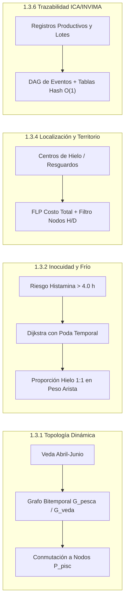
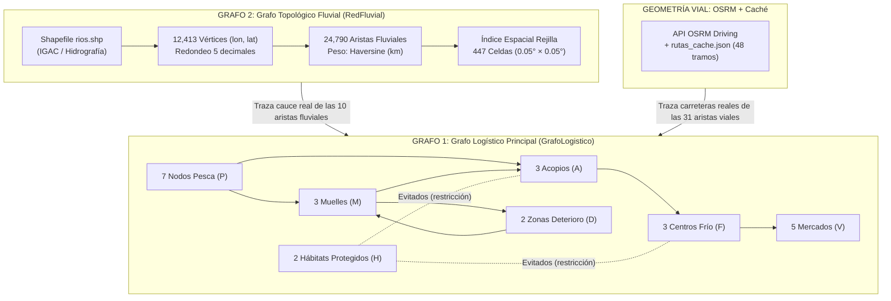

# 🐟 Informe Técnico Integral: Optimización de Centros de Refrigeración para Pesca Artesanal
### *Modelado Matemático, Estructuras de Datos de Grafos Multimodales, Catálogo de Vértices y Aristas, y Algoritmos de Optimización en Puerto Gaitán, Meta (Colombia)*

---

## 📋 Índice General
1. [Planteamiento del Problema, Problemáticas Reales (ECA) y Soluciones Algorítmicas](#1-planteamiento-del-problema-problemáticas-reales-eca-y-soluciones-algorítmicas)
   - [1.1 Contexto Territorial y el Cuello de Botella Biológico-Térmico](#11-contexto-territorial-y-el-cuello-de-botella-biológico-térmico)
   - [1.2 Jerarquía de Análisis y Orden de Prioridades del Proyecto](#12-jerarquía-de-análisis-y-orden-de-prioridades-del-proyecto)
   - [1.3 Problemáticas de la ECA con Solución Matemática y Computable en $G=(V,E)$](#13-problemáticas-de-la-eca-con-solución-matemática-y-computable-en-gve)
   - [1.4 Delimitación Interdisciplinar: Alcance Algorítmico vs. Áreas Externas](#14-delimitación-interdisciplinar-alcance-algorítmico-vs-áreas-externas)
2. [Creación y Estructuras de Datos de los Grafos en Memoria](#2-creación-y-estructuras-de-datos-de-los-grafos-en-memoria)
   - [2.1 Grafo 1: Grafo Logístico Principal (`GrafoLogistico`)](#21-grafo-1-grafo-logístico-principal-grafologistico)
   - [2.2 Grafo 2: Grafo Topológico de la Red Fluvial (`RedFluvial`)](#22-grafo-2-grafo-topológico-de-la-red-fluvial-redfluvial)
   - [2.3 Malla Vial Terrestre con Geometría Real (`route_geometry.py` + OSRM)](#23-malla-vial-terrestre-con-geometría-real-route_geometrypy--osrm)
3. [Catálogo Detallado de los 25 Vértices (Nodos) y su Efecto en la Red](#3-catálogo-detallado-de-los-25-vértices-nodos-y-su-efecto-en-la-red)
   - [3.1 Estructura de Datos de un Vértice (`Nodo`)](#31-estructura-de-datos-de-un-vértice-nodo)
   - [3.2 Comportamiento Matemático y Operativo por Tipo de Vértice (`P, M, A, F, D, H, V`)](#32-comportamiento-matemático-y-operativo-por-tipo-de-vértice-p-m-a-f-d-h-v)
   - [3.3 Detalle Individual de los 25 Vértices del Proyecto](#33-detalle-individual-de-los-25-vértices-del-proyecto)
4. [Variables, Ecuaciones y Catálogo Completo de las 41 Aristas](#4-variables-ecuaciones-y-catálogo-completo-de-las-41-aristas)
   - [4.1 Las 22 Variables y Propiedades Derivadas de cada Arista](#41-las-22-variables-y-propiedades-derivadas-de-cada-arista)
   - [4.2 Fórmulas Exactas de Cálculo en cada Arista](#42-fórmulas-exactas-de-cálculo-en-cada-arista)
   - [4.3 Ejemplo de Cálculo Paso a Paso con Datos Reales](#43-ejemplo-de-cálculo-paso-a-paso-con-datos-reales)
   - [4.4 Tabla Maestra de las 41 Aristas y sus Valores Calculados](#44-tabla-maestra-de-las-41-aristas-y-sus-valores-calculados)
5. [Algoritmos y Operaciones Implementados desde Cero](#5-algoritmos-y-operaciones-implementados-desde-cero)
   - [5.1 Distancia Geodésica de Haversine](#51-distancia-geodésica-de-haversine)
   - [5.2 Algoritmo de Dijkstra con Cola de Prioridad Binaria (`heapq`)](#52-algoritmo-de-dijkstra-con-cola-de-prioridad-binaria-heapq)
   - [5.3 Algoritmo de Bellman-Ford y Detección de Ciclos Negativos](#53-algoritmo-de-bellman-ford-y-detección-de-ciclos-negativos)
   - [5.4 Algoritmo de Floyd-Warshall (Todos los Pares)](#54-algoritmo-de-floyd-warshall-todos-los-pares)
   - [5.5 Simulación Térmica Paso a Paso de la Cadena de Frío](#55-simulación-térmica-paso-a-paso-de-la-cadena-de-frío)
   - [5.6 Problema de Localización de Instalaciones (FLP Greedy y MILP)](#56-problema-de-localización-de-instalaciones-flp-greedy-y-milp)
   - [5.7 Planificador de Itinerarios Multimodales con Acopio Obligatorio](#57-planificador-de-itinerarios-multimodales-con-acopio-obligatorio)
6. [Resultados Integrales del Modelo](#6-resultados-integrales-del-modelo)
7. [Arquitectura de Archivos y Comandos de Ejecución](#7-arquitectura-de-archivos-y-comandos-de-ejecución)

---

## 1. Planteamiento del Problema, Problemáticas Reales (ECA) y Soluciones Algorítmicas

### 1.1 Contexto Territorial y el Cuello de Botella Biológico-Térmico

En el municipio de **Puerto Gaitán (Meta, Colombia)**, las asociaciones de pescadores artesanales extraen diariamente alrededor de **265.75 kg/día** (con picos estacionales mucho mayores) en las cuencas de los ríos **Meta**, **Manacacías** e **Iteviare** (e interconexión hídrica con los ríos Tomo, Muco, Guarrojo, Planas, Tillavá, Uva, Yucao y Metica).

El pescado fresco (especialmente la cachama *Colossoma macropomum* y grandes bagres) es un alimento altamente perecedero:
- A la temperatura ambiente promedio de los Llanos Orientales ($30\ ^\circ\text{C}$), la actividad enzimática y bacteriana degrada el tejido muscular a una **tasa base del $2.5\%$ por cada hora sin refrigeración** (y del **$3.75\%/\text{h}$** en tramos expuestos de deterioro crítico `D`), con una vida útil total de apenas $6\text{ horas}$.
- Existe un **límite sanitario estricto de la FAO de $4.0\text{ horas}$ ($240\text{ minutos}$)** fuera de la cadena de frío. Superar este umbral provoca multiplicación bacteriana acelerada, generación de **histamina** (riesgo tóxico irreversible) y pérdidas poscaptura de hasta el **$40\%$**.
- Al ingresar a un centro de refrigeración ($0\ ^\circ\text{C}$) o mantener proporción de hielo $1:1$, el reloj térmico se estabiliza y la vida útil comercial se extiende hasta **$360\text{ horas}$ ($15\text{ días}$)**.

Para modelar y resolver este problema sin depender de aproximaciones irreales (como líneas rectas entre puntos o grafos simples de una sola variable), el proyecto construye un **sistema de doble grafo multimodal** ($G = (V, E)$) donde cada río, muelle, camino veredal, centro de acopio, cuarto frío, zona crítica de calor, hábitat protegido y tienda de venta final opera con sus propias reglas matemáticas.

---

### 1.2 Jerarquía de Análisis y Orden de Prioridades del Proyecto

Antes de ejecutar cualquier algoritmo de rutas o localización, el modelo establece una jerarquía estricta de análisis y priorización en cuatro niveles:

1. **Prioridad 0 — El Reloj Biológico-Sanitario (Tiempo sin frío sobre distancia):**
   Lo primordial no son los kilómetros lineales, sino el **tiempo acumulado de exposición térmica** antes de tocar hielo ($t_{\text{sin frío}} \le 4.0\text{ h}$). Un tramo corto en canoa por un meandro lento o una espera de $15\text{ minutos}$ al sol en un muelle sin techo degrada más el producto que decenas de kilómetros por vía pavimentada.
2. **Prioridad 1 — Levantamiento Topológico y Flujo Multimodal Obligatorio (`ADR-04`, `ADR-06`):**
   El pescado no puede saltar del río al camión frigorífico en línea recta. Debe cumplir la secuencia física real de la cuenca:
   $$\text{Pesca }(P) \xrightarrow{\text{río}} \text{Muelle }(M) \xrightarrow{\text{acceso local}} \text{Acopio }(A) \xrightarrow{\text{carretera}} \text{Centro de Frío }(F) \xrightarrow{\text{carretera}} \text{Venta }(V)$$
   *(Con la única excepción de `P06` Desembarcadero Central, ubicado en el casco urbano junto a `F02`).*
3. **Prioridad 2 — Ponderación Multicriterio de 6 Factores en cada Arista (`ADR-02`):**
   Cada arista $(i, j) \in E$ prioriza matemáticamente seis dimensiones operativas normalizadas:
   $$w_{ij} = \underbrace{0.25\,\hat{t}_{ij}}_{\text{1.º Tiempo}} + \underbrace{0.20\,\hat{c}_{ij}}_{\text{2.º Costo}} + \underbrace{0.20\,r_{\text{comb},ij}}_{\text{3.º Riesgo}} + \underbrace{0.10\,\hat{p}_{ij}}_{\text{4.º Pérdida}} + \underbrace{0.10\,(1 - q_{ij})}_{\text{5.º Inestabilidad}} + \underbrace{0.05\,P_{\text{ret},ij}}_{\text{6.º Retraso}}$$
4. **Prioridad 3 — Orden de Decisión Algorítmica:**
   - **Primero (Restricciones duras innegociables):** Respetar la exclusión de hábitats protegidos (`H01`, `H02` con `evitar_restringidos=True`) y garantizar el $100\%$ de cobertura sanitaria ($t \le 4.0\text{ h}$).
   - **Segundo (Optimización de rutas en grafos propios):** Calcular caminos mínimos con **Dijkstra** ($O((V+E)\log V)$), auditar consistencia y ausencia de ciclos negativos con **Bellman-Ford** ($O(V\cdot E)$) y construir la matriz global con **Floyd-Warshall** ($O(V^3)$).
   - **Tercero (Eficiencia económica FLP):** Entre los escenarios que cumplen el límite sanitario de $4.0\text{ h}$, seleccionar la configuración de centros de frío que minimice la suma de costos fijos mensuales de operación, costos de transporte y merma térmica.

---

### 1.3 Problemáticas de la ECA con Solución Matemática y Computable en $G=(V,E)$

En el marco de la **Escuela de Campo Agropecuaria (ECA — Proyecto Código `C05-01-2026-003`)** desarrollada junto a la Universidad de los Llanos (GRITOX, SUSA), la Alcaldía de Puerto Gaitán, la Corporación Kotsala y la AUNAP (*"Piscicultura Sostenible con Especies Nativas como Alternativa Productiva para Pescadores Artesanales durante la Veda Abril–Junio"*), se identifican seis problemáticas estructurales del sector pesquero y acuícola que **tienen solución matemática directa y computable** dentro de nuestra arquitectura de grafos:



#### 1.3.1. Modelado de la Veda mediante Grafos Bitemporales ($G_{\text{pesca}}$ y $G_{\text{veda}}$)
* **Problemática planteada en la ECA:** Durante el periodo de **abril a junio** se prohíbe legal y biológicamente la captura extractiva en los ríos (veda de reproducción regulada por la AUNAP), activándose la **piscicultura sostenible con especies nativas** como alternativa productiva para sostener el ingreso y la seguridad alimentaria de las familias pescadoras.
* **Solución algorítmica y de estructuras de datos:**
  * Se modela la red logística como un **grafo dependiente del tiempo (*Time-Varying Graph*)** $G(t) = (V, E(t))$ gobernado por dos matrices de adyacencia o máscaras booleanas de activación de orígenes:
    * **Régimen 1 — Captura Extractiva (Julio–Marzo, $G_{\text{pesca}}$):** Los vértices de origen activos $P$ corresponden a los 7 puntos de pesca artesanal sobre los ríos (`P01` a `P07`), con flujo predominantemente fluvial hacia los muelles `M01`–`M03`.
    * **Régimen 2 — Época de Veda (Abril–Junio, $G_{\text{veda}}$):** Se inhabilitan las aristas de extracción fluvial y las fuentes activas del grafo conmutan a los nodos de estanques de piscicultura nativa ($P_{\text{pisc}}$) en tierra firme.
  * **Efecto computable:** Al ejecutar **Dijkstra** y **Floyd-Warshall** bajo ambos regímenes, el sistema cuantifica automáticamente cómo se desplaza la centralidad de la red: durante la veda cae la carga sobre los muelles fluviales ($M$) y se incrementa el flujo sobre las aristas de `acceso_local` y los centros de acopio terrestres ($A$), permitiendo reasignar vehículos sin dejar ocioso el centro de frío `F02`.

#### 1.3.2. Mitigación del Riesgo de Histamina: Restricción Dura de Inocuidad FAO ($t \le 4.0\text{ h}$)
* **Problemática planteada en la ECA (Diapositivas 28–30):** La exposición del pescado a $30\ ^\circ\text{C}$ sin hielo provoca deterioro organoléptico acelerado (hundimiento ocular, pardeamiento de branquias, pérdida de firmeza) y **multiplicación bacteriana con formación de histamina** (intoxicación alimentaria grave que no se elimina ni siquiera cocinando o congelando el pescado posteriormente).
* **Solución algorítmica y de estructuras de datos:**
  * Se incorpora sobre el recorrido de caminos mínimos (**Dijkstra** y el simulador térmico `SimuladorCadenaFrio` en `src/optimization/cold_chain.py`) una restricción de **Camino Más Corto Restringido por Tiempo (*Constrained Shortest Path*)**:
    $$\sum_{e \in \text{ruta}(P_i \to F_j)} t_{\text{efectivo}}(e) + \sum_{v \in \text{transbordos}} t_{\text{espera}}(v) \le t_{\text{límite FAO}} \quad (4.0\text{ h} = 240\text{ min})$$
  * Cuando una ruta candidata hacia un centro de frío supera las $4.0\text{ horas}$ acumuladas sin refrigeración, el evaluador marca la ruta en **violación sanitaria (`cumple_limite_tiempo = False`)**, descarta la factibilidad operativa del escenario y cuantifica la merma acumulada tramo por tramo:
    $$D_{\text{acum}} = D_0 + \sum_{k} \left(r_{\text{base}} \cdot \phi_D(v_k) \cdot t_k\right)$$
    donde $r_{\text{base}} = 2.5\%/\text{h}$ a $30\ ^\circ\text{C}$ y $\phi_D(v_k) = 1.5$ si el tramo cruza una zona crítica de deterioro (`D01`, `D02`).

#### 1.3.3. Dimensionamiento y Ruteo del Insumo Crítico: Proporción Hielo-Pescado ($1:1$)
* **Problemática planteada en la ECA (Diapositiva 29):** Las Buenas Prácticas de Pesca (BPP) exigen transportar y aplicar una **proporción óptima de hielo en escarcha y pescado de $1:1$ en peso** ($1\text{ kg}$ de hielo por cada $1\text{ kg}$ de pescado) en recipientes isotérmicos no porosos (plástico sanitario o fibra de vidrio, erradicando la madera).
* **Solución algorítmica y de estructuras de datos:**
  * En nuestro modelo (`RELACION_HIELO_PESCADO = 1.0` y `COSTO_HIELO_KG = 800` COP/kg en `src/utils/constants.py`), el abastecimiento de hielo duplica la masa bruta movilizada en la cadena ($M_{\text{total}} = Q_{\text{pescado}} + Q_{\text{hielo}} = 2\,Q_{\text{pescado}}$).
  * El peso multicriterio $w_{ij}$ y el evaluador económico integran tanto el costo del insumo de hielo ($c_{\text{hielo}} = 800\text{ COP/kg} \times q_i$) como la restricción de capacidad de carga por arista (`capacidad_kg` en `aristas.csv` y `CAPACIDAD_VEHICULO_KG = 2000`), permitiendo modelar el **flujo bidireccional**: envío de hielo desde el centro de frío (`F02`) hacia los muelles (`M01`–`M03`) y retorno con pescado refrigerado.

#### 1.3.4. Ubicación Óptima de Centros de Hielo y Frío: Facility Location Problem (FLP)
* **Problemática planteada en la ECA (Diapositiva 30):** Se plantea la disyuntiva de *"implementar centros de acopio de hielo gestionados por cooperativas en los muelles"* frente a centralizar plantas frigoríficas donde exista red eléctrica confiable y acceso vial.
* **Solución algorítmica y de estructuras de datos:**
  * Nuestro módulo `src/optimization/facility_location.py` y `scenario_evaluator.py` resuelve formalmente el **Problema de Localización de Instalaciones con Restricciones de Capacidad y Tiempo (Capacitated / p-Median & Fixed-Charge FLP)**:
    $$\min_{y_j,\,x_{ij}} \;\; \sum_{j \in F} f_j\,y_j \;+\; \sum_{i \in P} \sum_{j \in F} \Big(c_{\text{transp}}(i,j) + c_{\text{hielo}}(i) + c_{\text{merma}}(i,j)\Big)\,x_{ij}$$
    sujeto a:
    $$\sum_{j \in F} x_{ij} = 1 \;\;\forall i \in P, \qquad x_{ij} \le y_j, \qquad t_{\text{sin frío}}(i, j)\,x_{ij} \le 4.0\text{ h}, \qquad \sum_{i \in P} q_i\,x_{ij} \le C_j\,y_j$$
  * **Resultado demostrable:** El algoritmo prueba matemáticamente que abrir **únicamente el Centro de Frío `F02` (Puerto Gaitán urbano)** logra el **$100\%$ de cumplimiento sanitario FAO** para las 7 asociaciones (incluso la más lejana `P05` Puerto Trujillo a $63\text{ km}$, que ingresa a frío en $2.20\text{ h} \le 4.0\text{ h}$) con un costo total optimizado de **$\$13,023,272\text{ COP/mes}$**, ahorrando **$\$10,000,000\text{ COP/mes}$** frente a operar simultáneamente las 3 plantas (`F01 + F02 + F03` = $\$23,023,272\text{ COP/mes}$), y abasteciendo de hielo a los muelles como nodos de transferencia rápida.

#### 1.3.5. Restricciones Ambientales, Hidrografía SIG y Territorios Indígenas (Nodos `H` y `D`)
* **Problemática planteada en la ECA (Diapositivas 6–8, 13–15, 25):** El ordenamiento pesquero (Cormacarena VIAM y SIMA Orinoquia) exige respetar áreas de conservación ecológica, humedales de reproducción y la jurisdicción territorial de una densa red de **resguardos indígenas** (Sikuani de Awóliba, Corocito-Yopalito-Gualabo, Vencedor-Piripiri-Guamito-Matanegra).
* **Solución algorítmica y de estructuras de datos:**
  * **Nodos tipo `H` (`H01` Humedal Río Manacacías y `H02` Zona Reserva Indígena Corocito):** Son vértices reales del grafo con el atributo `restriccion_ambiental = True`. Cuando los algoritmos **Dijkstra**, **Bellman-Ford** y **Floyd-Warshall** se invocan con `evitar_restringidos = True`, podan en tiempo $O(1)$ cualquier transición que utilice un nodo `H` como vértice intermedio de paso, garantizando rutas respetuosas con las zonas de reserva y desove.
  * **Nodos tipo `D` (`D01` Paso Crítico Río Iteviare y `D02` Cruce Veredal La Culebra):** Modelan cuellos de botella geográficos donde las embarcaciones o vehículos sufren exposición solar extrema y baja velocidad, aplicando el multiplicador `FACTOR_ZONA_DETERIORO = 1.5` sobre la pérdida térmica del tramo.

#### 1.3.6. Estructuras de Datos para Trazabilidad y Registros Productivos (BPP / BPM / ICA / INVIMA)
* **Problemática planteada en la ECA (Diapositivas 22–27, 31):** Tanto la pesca extractiva como la piscicultura requieren llevar **registros sistemáticos** (biometrías, densidades de siembra, mortalidad, temperaturas, tiempos de traslado y lotes) para asegurar rentabilidad y trazabilidad sanitaria ante el ICA y el INVIMA.
* **Solución algorítmica y de estructuras de datos:**
  * **Grafo Acíclico Dirigido (DAG) por lote:** Cada itinerario logístico de un lote capturado o cosechado constituye un camino dirigido acíclico con sellos de tiempo y estado térmico por etapa:
    $$\text{Captura/Cosecha }(P,\,t_0) \longrightarrow \text{Desembarque/Eviscerado }(M,\,t_1) \longrightarrow \text{Acopio e Hielo }(A,\,t_2) \longrightarrow \text{Abatimiento }0\ ^\circ\text{C }(F,\,t_3) \longrightarrow \text{Mercado }(V,\,t_4)$$
  * **Indexación en Tablas Hash $O(1)$:** El grafo principal almacena `_nodos: Dict[str, Nodo]` y `_adyacencia: Dict[str, List[Arista]]` mediante tablas hash en memoria con complejidad de consulta $O(1)$, donde cada `TramoRuta` registra exactamente `{origen, destino, distancia_km, tiempo_h, temp_c, perdida_tramo_pct, perdida_acumulada_pct, kg_restantes, refrigerado}`, proporcionando el registro digital auditable de principio a fin.

---

### 1.4 Delimitación Interdisciplinar: Alcance Algorítmico vs. Áreas Externas

Para mantener rigor ingenieril, el proyecto distingue explícitamente qué problemas resuelve nuestro software mediante **Estructuras de Datos y Teoría de Grafos** y cuáles dependen de **disciplinas externas complementarias**:

| Problemática de la Cadena Pesquera (ECA) | ¿Se resuelve con Grafos y Algoritmos? | Cómo actúa nuestro proyecto / Qué área externa se requiere |
| :--- | :---: | :--- |
| **Ruteo fluvial/terrestre antes del límite de $4.0\text{ h}$ (Histamina)** | **SÍ (100%)** | Resuelto con **Dijkstra + Simulación Térmica** sobre red real `rios.shp` y OSRM (`t <= 2.20 h` en todas las asociaciones). |
| **Dónde instalar centros de frío/hielo minimizando costos** | **SÍ (100%)** | Resuelto con **FLP (Greedy / MILP)** y evaluación de 5 escenarios (`Solo F02` ahorra $\$10\text{M COP/mes}$). |
| **Desvío de rutas fuera de hábitats y reservas protegidas** | **SÍ (100%)** | Resuelto mediante nodos `H` (`restriccion_ambiental=True`) y filtro `evitar_restringidos=True` en Dijkstra/Bellman-Ford/Floyd-Warshall. |
| **Transición operativa en época de veda (abril–junio)** | **SÍ (Modelado)** | Modelable mediante conmutación de nodos origen en grafo bitemporal ($G_{\text{pesca}} \leftrightarrow G_{\text{veda}}$). |
| **Trazabilidad de lotes, tiempos, costos y mermas** | **SÍ (100%)** | Estructuras `Nodo`, `Arista` (19 atributos), `ResultadoSimulacion` y exportación CSV/GeoJSON en $O(1)$. |
| **Medición química de mercurio ($\text{Hg}$) y metales pesados en peces** | **NO (Externa)** | Requiere **Toxicología Ambiental y Espectrometría de Laboratorio** (Grupo GRITOX — Unillanos). |
| **Definición biológica de fechas de desove y vedas** | **NO (Externa)** | Requiere **Biología Pesquera e Ictiología Continental** (AUNAP / Grupo SUSA). |
| **Inspección sensorial en vivo (brillo ocular, color de branquias)** | **NO (Externa)** | Requiere **Medicina Veterinaria, Zootecnia y Control de Calidad Organoléptico** en puerto (INVIMA). |
| **Sustitución física de cajas de madera por plástico y techado de muelles** | **NO (Externa)** | Requiere **Inversión Pública, Ingeniería Civil Portuaria y Dotación Cooperativa** (Alcaldía / AUNAP). |
| **Acuerdos de co-manejo y consulta previa con resguardos indígenas** | **NO (Externa)** | Requiere **Gobernanza Territorial, Derecho Constitucional y Trabajo Social Comunitario**. |
| **Formulación nutricional de alimento y sanidad en estanques piscícolas** | **NO (Externa)** | Requiere **Ingeniería Acuícola y Buenas Prácticas Acuícolas (BPA — ICA)**. |

---

## 2. Creación y Estructuras de Datos de los Grafos en Memoria

El software construye y coordina **dos grafos independientes hechos desde cero** en Python (sin usar `networkx` para los cálculos):



---

### 2.1 Grafo 1: Grafo Logístico Principal (`GrafoLogistico`)

Definido en [`src/models/grafo_logistico.py`](file:///c:/Users/padil/Desktop/Ingenieria%20de%20Sistemas/SEMESTRE%2003/603301%20-%20ESTRUCTURAS%20DE%20DATOS/Proyecto/src/models/grafo_logistico.py), modela la red macro de suministro como un **grafo dirigido ponderado** $G = (V, E)$ con $|V| = 25$ vértices y $|E| = 41$ aristas dirigidas.

#### Representación Interna en Memoria
Utiliza una **Lista de Adyacencia indexada por tabla hash (`dict`)**, acompañada de un diccionario directo de vértices:

```python
class GrafoLogistico:
    def __init__(self):
        # Diccionario O(1) para consultar los atributos de cualquier vértice por su ID
        self._nodos: Dict[str, Nodo] = {}
        
        # Lista de adyacencia: mapea cada ID de nodo origen a una lista de tuplas (id_destino, objeto Arista)
        self._adyacencia: Dict[str, List[Tuple[str, Arista]]] = defaultdict(list)
        
        # Contador de aristas en O(1)
        self._num_aristas: int = 0
```

#### ¿Cómo se construye paso a paso al ejecutar `main.py`?
1. **Lectura de Vértices (`cargar_nodos_csv`):**
   - Lee `data/csv/nodos_pesca.csv` $\rightarrow$ instancia 7 objetos `Nodo` de tipo `P` y llama a `grafo.agregar_nodo(nodo)`.
   - Lee `data/csv/nodos_centros.csv` $\rightarrow$ instancia 13 objetos `Nodo` de infraestructura (`3` tipo `F`, `3` tipo `A`, `3` tipo `M`, `2` tipo `D`, `2` tipo `H`) y los registra en `_nodos` y `_adyacencia`.
   - Lee `data/csv/nodos_destinos.csv` $\rightarrow$ instancia 5 objetos `Nodo` de tipo `V` (tiendas reales).
2. **Lectura y Validación de Aristas (`cargar_aristas_csv`):**
   - Lee las 41 filas de `data/csv/aristas.csv`.
   - Por cada fila, crea un objeto `Arista` con sus 19 atributos de entrada y calcula automáticamente en `__post_init__` los costos por defecto si alguno fuera cero.
   - Llama a `grafo.agregar_arista(arista)`, la cual verifica primero que tanto `arista.origen` como `arista.destino` existan en `self._nodos` (lanzando `KeyError` si no existen) e inserta la tupla `(arista.destino, arista)` en `self._adyacencia[arista.origen]`.

#### Operaciones Soportadas y su Complejidad Algorítmica

| Operación / Método | Qué hace internamente | Complejidad Temporal |
|---|---|---|
| `agregar_nodo(nodo)` | Inserta `self._nodos[nodo.id] = nodo` e inicializa su lista vacía en `self._adyacencia`. | $O(1)$ |
| `obtener_nodo(id_nodo)` | Busca y retorna el objeto `Nodo` desde el hash map `self._nodos`. | $O(1)$ |
| `eliminar_nodo(id_nodo)` | Borra la lista saliente de `id_nodo` y filtra todas las listas de `_adyacencia` para remover aristas entrantes hacia `id_nodo`. | $O(|V| + |E|)$ |
| `agregar_arista(arista)` | Valida existencia de extremos y hace `append((arista.destino, arista))` en `_adyacencia[origen]`. | $O(1)$ |
| `agregar_arista_auto(o, d)` | Calcula la distancia Haversine entre las coordenadas de `o` y `d`, estima el tiempo de viaje y crea la arista automáticamente. | $O(1)$ |
| `obtener_aristas(id_origen)` | Devuelve la lista de objetos `Arista` que salen de `id_origen`. | $O(\text{grado}^+(u))$ |
| `obtener_arista(o, d)` | Recorre los vecinos de `o` buscando el destino `d`. | $O(\text{grado}^+(o))$ |
| `nodos_por_tipo(tipo)` | Filtra comprensivamente `self._nodos.values()` según el código (`P, M, A, F, D, H, V`). | $O(|V|)$ |
| `matriz_adyacencia(criterio)` | Construye un diccionario 2D $|V| \times |V|$ con diagonal en $0.0$, $\infty$ donde no hay conexión, y el valor del criterio donde existe arista. | $O(|V|^2 + |E|)$ |

---

### 2.2 Grafo 2: Grafo Topológico de la Red Fluvial (`RedFluvial`)

Definido en [`src/visualization/river_network.py`](file:///c:/Users/padil/Desktop/Ingenieria%20de%20Sistemas/SEMESTRE%2003/603301%20-%20ESTRUCTURAS%20DE%20DATOS/Proyecto/src/visualization/river_network.py), resuelve el problema de que **las lanchas no vuelan en línea recta sobre la sabana, sino que deben seguir los meandros de los ríos**.

#### Proceso de Construcción desde el Shapefile (`rios.shp`)
1. **Reproyección y Recorte Espacial (`cargar_rios`):**
   - Carga `data/shapefiles/rios.shp` con `geopandas`, convierte el sistema de coordenadas a **WGS 84 (`EPSG:4326`)** y recorta las geometrías al cuadro delimitador de la cuenca operativa: $\text{lon} \in [-73.1^\circ, -71.3^\circ]$, $\text{lat} \in [3.9^\circ, 4.7^\circ]$.
   - Explota las geometrías `MultiLineString` en polilíneas simples `LineString`.
2. **Fusión Topológica de Vértices por Cuantización (`RedFluvial.__init__`):**
   - En un shapefile hidrográfico, distintos tramos de río se tocan en sus extremos con ligeras diferencias de punto flotante.
   - Para unirlos en un grafo conexo, cada coordenada $(x, y)$ de cada polilínea se redondea a **5 cifras decimales** (`Vertice = (round(lon, 5), round(lat, 5))`, equivalente a una resolución de $\approx 1.1\text{ metros}$).
   - Por cada par de puntos consecutivos $(a, b)$ de una línea del río, se calcula su distancia real en kilómetros mediante `haversine((a_lat, a_lon), (b_lat, b_lon))` y se inserta una **arista bidireccional** en `self.adyacencia[a]` y `self.adyacencia[b]`.
   - **Tamaño real resultante del grafo fluvial:** **$12,413\text{ vértices}$** y **$24,790\text{ aristas dirigidas}$** ($12,395$ segmentos de río navegables en ambos sentidos).
3. **Indexación Espacial en Rejilla Hash (`self._rejilla`):**
   - Buscar el punto de río más cercano a un punto de pesca comparando contra $12,413$ vértices tardaría demasiado si se hiciera por fuerza bruta repetidamente.
   - Se divide el mapa en celdas de $\Delta = 0.05^\circ \times 0.05^\circ$ ($\approx 5.5\text{ km} \times 5.5\text{ km}$) mediante la función hash entera:
     $$\text{celda}(lon, lat) = \left(\lfloor lon / 0.05 \rfloor, \; \lfloor lat / 0.05 \rfloor\right)$$
   - Esto agrupa los $12,413$ vértices en **447 celdas activas**. Cuando se consulta `nodo_mas_cercano(lat, lon)`, el algoritmo busca en anillos cuadrados concéntricos ($r = 0, 1, 2, \dots$) alrededor de la celda del punto y se detiene en cuanto la distancia hallada es menor que la cota inferior del siguiente anillo.
4. **Cálculo del Cauce Navegable (`RedFluvial.ruta`):**
   - Dado el nodo origen $(\text{lat}_1, \text{lon}_1)$ y destino $(\text{lat}_2, \text{lon}_2)$, halla sus vértices de río más cercanos $v_1$ (a distancia $d_1$) y $v_2$ (a distancia $d_2$).
   - Verifica que ambos puntos estén a menos de `DISTANCIA_MAX_ENLACE_KM = 5.0 km` de la orilla del río.
   - Ejecuta su propio **Dijkstra con cola de prioridad (`heapq`)** sobre los $12,413$ vértices del río para hallar la secuencia exacta de meandros $[v_1, \dots, v_2]$ y retorna las coordenadas completas junto con la longitud fluvial real $d_{\text{total}} = d_1 + d_{\text{río}}(v_1, v_2) + d_2$.

---

### 2.3 Malla Vial Terrestre con Geometría Real (`route_geometry.py` + OSRM)

Para las aristas de tipo `terrestre` y `acceso_local`, el módulo [`src/visualization/route_geometry.py`](file:///c:/Users/padil/Desktop/Ingenieria%20de%20Sistemas/SEMESTRE%2003/603301%20-%20ESTRUCTURAS%20DE%20DATOS/Proyecto/src/visualization/route_geometry.py) consulta el motor de ruteo vial **OSRM (Open Source Routing Machine)** sobre la cartografía de carreteras de OpenStreetMap:
```
http://router.project-osrm.org/route/v1/driving/{lon1},{lat1};{lon2},{lat2}?overview=full&geometries=geojson
```
Todas las polilíneas tanto viales (OSRM) como fluviales (`RedFluvial`) se almacenan en `data/output/rutas_cache.json` (**48 rutas cacheadas**), evitando depender de internet en ejecuciones posteriores.

---

## 3. Catálogo Detallado de los 25 Vértices (Nodos) y su Efecto en la Red

### 3.1 Estructura de Datos de un Vértice (`Nodo`)

Cada vértice es una instancia de la clase `@dataclass Nodo` definida en [`src/models/nodo.py`](file:///c:/Users/padil/Desktop/Ingenieria%20de%20Sistemas/SEMESTRE%2003/603301%20-%20ESTRUCTURAS%20DE%20DATOS/Proyecto/src/models/nodo.py):

| Atributo / Propiedad | Tipo de Dato | Descripción y Regla de Negocio |
|---|---|---|
| `id` | `str` | Identificador único del vértice en el grafo (ej. `"P01"`, `"M01"`, `"A02"`, `"F02"`, `"D01"`, `"H01"`, `"V_BOG1"`). Define el `__hash__` y `__eq__` del nodo. |
| `nombre` | `str` | Nombre real de la asociación, muelle, acopio, centro frigorífico o comercio. |
| `tipo` | `str` | Código de categoría validado en `__post_init__` contra `TipoNodo`: `P`, `M`, `A`, `F`, `D`, `H`, `V`. Si se pasa otro valor, lanza `ValueError`. |
| `latitud`, `longitud` | `float` | Coordenadas geográficas en grados decimales (WGS 84). |
| `produccion_kg_dia` | `float` | Kilogramos de pescado capturados por día (exclusivo de nodos tipo `P`; suma total = **265.75 kg/día**). |
| `capacidad_frio_kg` | `float` | Capacidad de almacenamiento refrigerado o con hielo en kg (presente en nodos `F` y `A`). |
| `costo_fijo` | `float` | Costo fijo mensual de operación y mantenimiento en pesos colombianos (COP/mes). |
| `tiene_muelle` | `bool` | `True` si cuenta con infraestructura física para atraque y descarga de embarcaciones. |
| `tiene_energia` | `bool` | `True` si posee suministro eléctrico estable (indispensable para operar compresores de frío). |
| `tiene_agua` | `bool` | `True` si dispone de agua potable para lavado y eviscerado. |
| `restriccion_ambiental` | `bool` | `True` en nodos de hábitat protegido (`H`), lo que bloquea su uso como nodo de paso intermedio. |
| `es_candidato_frio` *(propiedad)* | `bool` | Retorna `True` sí y solo si: `tipo in ("A", "F") and tiene_energia and not restriccion_ambiental`. |

---

### 3.2 Comportamiento Matemático y Operativo por Tipo de Vértice (`P, M, A, F, D, H, V`)

Cada categoría de vértice altera de forma distinta el cálculo de las rutas y la simulación térmica:

1. **🐟 `P` — Punto de Pesca (7 vértices: `P01` a `P07`):**
   - Son los **nodos fuente (orígenes de flujo)**. Inyectan al sistema una carga inicial $kg_{\text{inicial}} = \text{produccion\_kg\_dia}$ a temperatura ambiente ($30\ ^\circ\text{C}$) y con reloj térmico `tiempo_sin_frio = 0.0 h`.
2. **⚓ `M` — Muelle Fluvial (3 vértices: `M01`, `M02`, `M03`):**
   - Son **nodos de transbordo multimodal** donde la carga pasa de lancha a vehículo terrestre.
   - **Efecto matemático en `SimuladorCadenaFrio`:** Al llegar a un nodo tipo `M`, el pescado no recibe refrigeración y sufre una penalización por maniobra de descargue y pesaje igual a `TIEMPO_TRANSBORDO_MUELLE_H = 0.25 h` (15 minutos adicionales bajo el sol), incrementando `tiempo_sin_frio` y sumando `+1` al contador `num_transbordos`.
3. **📦 `A` — Centro de Acopio (3 vértices: `A01`, `A02`, `A03`):**
   - Son **nodos de consolidación obligatoria** según la regla logística ADR-06: todo punto de pesca rural debe consolidar su captura en un centro de acopio antes de despacharse hacia un centro de frío principal (con la única excepción de `P06`, que desembarca directamente en el casco urbano junto a `F02`).
   - Además, si el acopio tiene `capacidad_frio_kg > 0` (con camas de hielo), estabiliza la temperatura a $0\ ^\circ\text{C}$ y **reinicia el reloj `tiempo_sin_frio = 0.0 h`**.
   - **Nota sobre `A03` (Puerto Trujillo):** Aunque tiene capacidad de acopio en cajas isotérmicas (`800 kg`), **no tiene energía eléctrica confiable (`tiene_energia = False`)**, por lo que la propiedad `es_candidato_frio` devuelve `False` y el algoritmo de localización de instalaciones (FLP) lo descarta automáticamente como sede de planta frigorífica.
4. **❄️ `F` — Centro de Frío / Red Frigorífica (3 vértices: `F01`, `F02`, `F03`):**
   - Son **nodos de abatimiento térmico y almacenamiento refrigerado** con energía eléctrica continua (`tiene_energia = True`).
   - Al pasar por un nodo `F`, la temperatura del lote baja a `TEMP_OBJETIVO_C = 0.0 °C`, se **reinicia `tiempo_sin_frio = 0.0 h`** y se contabiliza una parada frigorífica (`num_paradas_frio += 1`).
5. **🌡️ `D` — Zona de Deterioro Térmico Crítico (2 vértices: `D01`, `D02`):**
   - Representan pasos viales críticos (tramos destapados de sabana expuestos a alta radiación solar, sin sombra ni asistencia).
   - **Efecto matemático en `SimuladorCadenaFrio`:** Cuando un tramo tiene como destino un nodo tipo `D`, la tasa de deterioro biológico de ese tramo se multiplica por **`FACTOR_DETERIORO_ZONA_D = 1.5`** (un **50% más de pérdida de pescado** en ese segmento), registrando la alerta `"Zona de deterioro ×1.5"`. En el mapa se visualizan con un radio de amenaza de $1,500\text{ m}$.
6. **🌿 `H` — Hábitat Protegido (2 vértices: `H01`, `H02`):**
   - Representan zonas de desove, humedales y rondas hídricas protegidas con `restriccion_ambiental = True`.
   - **Efecto matemático en Dijkstra, Bellman-Ford y Floyd-Warshall:** Cuando se invocan con `evitar_restringidos = True`, cualquier vértice con `restriccion_ambiental == True` queda **bloqueado como nodo intermedio de paso**. Aunque existen atajos geográficos tentadores a través de ellos (por ejemplo, `P04 → H01 → A01` toma solo $0.20\text{ h}$ frente a $0.25\text{ h}$ de la vía legal `P04 → A01`), el algoritmo descarta el paso por `H01` y reporta explícitamente `evita hábitat: H01`. En el mapa se rodean con un perímetro de exclusión de $2,000\text{ m}$.
7. **🏪 `V` — Lugar de Venta / Mercado Final (5 vértices: `V_PG1`, `V_PG2`, `V_VLL`, `V_BOG1`, `V_BOG2`):**
   - Son los **nodos sumidero (destinos comerciales reales)** en Puerto Gaitán, Villavicencio y Bogotá donde se entrega el pescado y se evalúa si el tiempo acumulado sin frío desde la última refrigeración cumplió la norma ($\le 4.0\text{ h}$).

---

### 3.3 Detalle Individual de los 25 Vértices del Proyecto

#### A. Puntos de Pesca (`P01` – `P07`) — Archivo `data/csv/nodos_pesca.csv`

| ID | Nombre Oficial | Latitud | Longitud | Producción (`kg/día`) | Río Asociado | Nº Pescadores | Descripción y Contexto Real |
|---|---|---|---|---|---|---|---|
| **`P01`** | ASOPESGA - Alto Neblinas | `4.3500` | `-72.1200` | **65.75** | Río Manacacías | 14 | Asociación principal de Puerto Gaitán (~24 ton/año históricas). Conecta por río con `A02` y `M03`. |
| **`P02`** | Atarraya Verde | `4.3300` | `-72.1000` | **40.00** | Río Manacacías | 20 | Producción piscícola y pesca en jaulas flotantes. Tiene salida fluvial a `M03` y acceso local a `A02`. |
| **`P03`** | Asovida - San Miguel | `4.2900` | `-72.0600` | **25.00** | Río Meta | 11 | Comunidad pesquera en la vereda San Miguel sobre el río Meta. Conecta con `M01` y `A01`. |
| **`P04`** | Asopespor | `4.3000` | `-72.0700` | **20.00** | Río Meta | 10 | Punto de captura sobre el río Meta. Posee un atajo fluvial por el hábitat `H01` que el algoritmo debe evitar. |
| **`P05`** | Puerto Trujillo | `4.1500` | `-71.5000` | **30.00** | Río Iteviare | 40 | Zona rural más apartada (~65 km al sureste, 40 familias). Requiere navegar a `A03` y cruzar tramos difíciles. |
| **`P06`** | Desembarcadero Central | `4.3130` | `-72.0830` | **50.00** | Río Meta | 25 | Punto de desembarque en el casco urbano de Puerto Gaitán, contiguo a `M03` y `F02` (excepción ADR-06). |
| **`P07`** | Soplaviento | `4.3400` | `-72.1100` | **35.00** | Río Manacacías | 8 | Ensenada y sitio experimental en el río Manacacías. Navega hacia `A02` o `M03`. |

#### B. Nodos de Infraestructura, Muelles, Deterioro y Hábitat (`F`, `A`, `M`, `D`, `H`) — Archivo `data/csv/nodos_centros.csv`

| ID | Nombre | Tipo | Latitud | Longitud | Cap. Frío (`kg`) | Costo Fijo (`COP/mes`) | Energía | Agua | Muelle | Restr. Amb. | Candidato FLP | Rol en el Grafo |
|---|---|---|---|---|---|---|---|---|---|---|---|---|
| **`F01`** | Centro Frío Alto Neblinas | `F` | `4.3450` | `-72.1150` | 2,000 | \$5,000,000 | Sí | Sí | Sí | No | ✅ Sí | Planta frigorífica candidata en sector Alto Neblinas. |
| **`F02`** | Centro Frío Puerto Gaitán | `F` | `4.3128` | `-72.0826` | 5,000 | \$3,000,000 | Sí | Sí | Sí | No | ✅ Sí | **Nodo central óptimo:** planta principal en el casco urbano donde convergen todos los flujos antes de salir a Villavicencio/Bogotá. |
| **`F03`** | Centro Frío Puerto López | `F` | `4.0862` | `-72.9550` | 4,000 | \$4,500,000 | Sí | Sí | Sí | No | ✅ Sí | **Nodo de re-enfriamiento en ruta:** ubicado a 126 km de Puerto Gaitán sobre la Ruta Nacional 40; reinicia el reloj térmico a $0\text{ h}$ antes de subir a Villavicencio y Bogotá. |
| **`A01`** | Acopio San Miguel | `A` | `4.2900` | `-72.0600` | 1,000 | \$2,500,000 | Sí | Sí | No | No | ✅ Sí | Consolida la pesca de la cuenca del Río Meta (`P03`, `P04`, y el flujo lejano de `P05`). |
| **`A02`** | Acopio Río Manacacías | `A` | `4.3350` | `-72.1050` | 1,500 | \$3,500,000 | Sí | Sí | Sí | No | ✅ Sí | Consolida toda la cuenca del Río Manacacías (`P01`, `P02`, `P07`). |
| **`A03`** | Acopio Puerto Trujillo | `A` | `4.1500` | `-71.5000` | 800 | \$2,000,000 | **No** | Sí | Sí | No | ❌ No | Primer punto de recepción para `P05`. Sin red eléctrica estable. |
| **`M01`** | Muelle Río Meta Alto | `M` | `4.1298` | `-72.1088` | 0 | \$0 | No | Sí | Sí | No | ❌ No | Desembarcadero fluvial del sector alto del río Meta; suma $+0.25\text{ h}$ por transbordo. |
| **`M02`** | Muelle Río Meta Central | `M` | `4.1680` | `-72.1050` | 0 | \$0 | No | Sí | Sí | No | ❌ No | Punto de enlace entre la ruta sur (`D01`) y el acopio `A01`; suma $+0.25\text{ h}$ de transbordo. |
| **`M03`** | Muelle Puerto Gaitán | `M` | `4.3130` | `-72.0830` | 0 | \$0 | Sí | Sí | Sí | No | ❌ No | Muelle principal del casco urbano; recibe botes de `P01`, `P02`, `P06` y `P07`. |
| **`D01`** | Zona Deterioro Térmico Ruta Sur | `D` | `4.1150` | `-72.0550` | 0 | \$0 | No | No | No | No | ❌ No | Tramo crítico entre `A03`/`M01` y `M02`: **multiplica por $\times 1.5$** el deterioro del pescado que lo cruza. |
| **`D02`** | Zona Deterioro Ruta Meta | `D` | `4.2446` | `-72.0680` | 0 | \$0 | No | No | No | No | ❌ No | Ruta secundaria deteriorada entre `A01` y `F02` ($\times 1.5$ deterioro). |
| **`H01`** | Hábitat Protegido Río Meta | `H` | `4.2860` | `-72.0430` | 0 | \$0 | No | No | No | **Sí** | ❌ No | Área de desove y reproducción en el río Meta. **Bloqueado como paso intermedio** (`evitar_restringidos=True`). |
| **`H02`** | Hábitat Protegido Manacacías | `H` | `4.3559` | `-72.0504` | 0 | \$0 | No | No | No | **Sí** | ❌ No | Ronda hídrica protegida entre `F01` y `F02`. **Bloqueado como paso intermedio**. |

#### C. Mercados y Puntos de Venta Reales (`V`) — Archivo `data/csv/nodos_destinos.csv`

| ID | Comercio / Mercado | Ciudad | Latitud | Longitud | Demanda (`kg/día`) | Dirección Física Verificada |
|---|---|---|---|---|---|---|
| **`V_PG1`** | Llanofish Fishing Store | Puerto Gaitán | `4.3120` | `-72.0835` | 80 | Carrera 9A No. 6-03, Barrio El Triunfo, Puerto Gaitán |
| **`V_PG2`** | Tienda El Pavón | Puerto Gaitán | `4.3135` | `-72.0820` | 60 | Carrera 9 No. 9-07, Barrio Centro, Puerto Gaitán |
| **`V_VLL`** | Amigos de la Pesca | Villavicencio | `4.1387` | `-73.6310` | 300 | C.C. Los Centauros, Local 82 (Cra. 31 # 37-32), Villavicencio |
| **`V_BOG1`** | Buceo y Pesca | Bogotá D.C. | `4.6615` | `-74.0590` | 400 | Carrera 14 # 78-40, Chapinero, Bogotá |
| **`V_BOG2`** | Aqualand Sports | Bogotá D.C. | `4.6820` | `-74.0720` | 500 | Carrera 47A # 93-57, La Castellana, Barrios Unidos, Bogotá |

---

## 4. Variables, Ecuaciones y Catálogo Completo de las 41 Aristas

### 4.1 Las 22 Variables y Propiedades Derivadas de cada Arista

En [`src/models/arista.py`](file:///c:/Users/padil/Desktop/Ingenieria%20de%20Sistemas/SEMESTRE%2003/603301%20-%20ESTRUCTURAS%20DE%20DATOS/Proyecto/src/models/arista.py), cada conexión dirigida $(i, j)$ almacena **19 atributos base** y calcula **6 propiedades matemáticas derivadas**:

1. **`origen`** (`str`): ID del vértice de salida $i$.
2. **`destino`** (`str`): ID del vértice de llegada $j$.
3. **`distancia_km`** ($d_{ij}$, `float`): Longitud del tramo en kilómetros.
4. **`tiempo_h`** ($t_{ij}$, `float`): Tiempo neto de desplazamiento en horas.
5. **`costo_cop`** ($C_{\text{flete}}$, `float`): Costo operativo de transporte en COP (si no se especifica, se calcula como $d_{ij} \times \$3,500\text{ COP/km}$).
6. **`riesgo_termico`** ($R_{\text{term}} \in [0,1]$): Probabilidad de exposición térmica severa en el tramo.
7. **`estado_via`** (`"buena" | "regular" | "mala"`): Condición física de la superficie vial o del cauce fluvial.
8. **`tipo_via`** (`"fluvial" | "acceso_local" | "terrestre"`): Modalidad de transporte del arco.
9. **`capacidad_kg`** (`float`): Capacidad máxima por viaje del medio de transporte en ese arco ($300\text{ kg}$ a $2,000\text{ kg}$).
10. **`prob_retraso`** ($P_{\text{ret}} \in [0,1]$): Probabilidad de demoras operativas en el tramo.
11. **`riesgo_accidente`** ($R_{\text{acc}} \in [0,1]$): Índice de accidentalidad vial o fluvial.
12. **`riesgo_derrumbe`** ($R_{\text{der}} \in [0,1]$): Probabilidad de cierre por deslizamiento de tierra (crítico en la cordillera Oriental hacia Bogotá).
13. **`restriccion_peso_ton`** (`float`): Peso bruto vehicular máximo permitido en toneladas ($0 = \text{sin restricción}$).
14. **`peajes`** ($n_{\text{peajes}}$, `int`): Número de casetas de peaje en la vía nacional.
15. **`costo_peajes_cop`** ($C_{\text{peajes}}$, `float`): Costo total de peajes en COP ($n_{\text{peajes}} \times \$12,000\text{ COP}$).
16. **`horario_restriccion`** (`"ninguno" | "nocturno" | "diurno"`): Restricciones horarias de circulación de carga.
17. **`flujo_vehicular`** (`"bajo" | "medio" | "alto"`): Nivel de tráfico que ralentiza la velocidad media.
18. **`tiempo_espera_h`** ($t_{\text{esp}}$, `float`): Tiempo muerto en horas por espera de carga, fila en peajes o atraque.
19. **`confiabilidad_via`** ($\text{conf} \in [0,1]$): Índice de disponibilidad y seguridad estructural de la ruta.
20. **`num_transbordos`** (`int`): Cambios de vehículo asociados al arco.
21. **Propiedades derivadas:** `factor_estado_via` ($F_{\text{vía}}$), `factor_flujo` ($F_{\text{flujo}}$), `tiempo_efectivo_h` ($t_{\text{ef}}$), `costo_total_cop` ($C_{\text{tot}}$), `riesgo_combinado` ($R_{\text{comb}}$), `perdida_esperada` ($L_{ij}$).
22. **Peso Multicriterio (`peso_default` / $w_{ij}$):** Funcional de costo adimensional que integra los 6 criterios de decisión.

---

### 4.2 Fórmulas Exactas de Cálculo en cada Arista

Para toda arista $e = (i, j)$, el modelo evalúa en orden las siguientes ecuaciones:

#### 1. Multiplicadores de Estado de Vía y Flujo Vehicular
$$F_{\text{vía}} = \begin{cases} 1.0 & \text{si } \text{estado\_via} = \text{``buena''} \\ 1.5 & \text{si } \text{estado\_via} = \text{``regular''} \\ 2.0 & \text{si } \text{estado\_via} = \text{``mala''} \end{cases} \qquad;\qquad F_{\text{flujo}} = \begin{cases} 1.00 & \text{si } \text{flujo\_vehicular} = \text{``bajo''} \\ 1.15 & \text{si } \text{flujo\_vehicular} = \text{``medio''} \\ 1.35 & \text{si } \text{flujo\_vehicular} = \text{``alto''} \end{cases}$$

#### 2. Tiempo Efectivo de Tránsito ($t_{\text{ef}}$)
$$t_{\text{ef}} = \left(t_{ij} \times F_{\text{flujo}}\right) + t_{\text{esp}}$$

#### 3. Costo Total del Tramo ($C_{\text{tot}}$)
$$C_{\text{tot}} = C_{\text{flete}} + C_{\text{peajes}}$$

#### 4. Riesgo Combinado ($R_{\text{comb}}$)
Integra el riesgo térmico (50%), el riesgo de accidente (25%) y el riesgo de derrumbe (25%):
$$R_{\text{comb}} = \min\Big(0.50 \cdot R_{\text{term}} + 0.25 \cdot R_{\text{acc}} + 0.25 \cdot R_{\text{der}}, \; 1.0\Big)$$

#### 5. Pérdida Esperada en el Tramo ($L_{ij}$ en $\%$)
Calcula el porcentaje estimado de deterioro del producto en función del tiempo efectivo, el golpeteo por mal estado de la vía, la falta de confiabilidad y la probabilidad de retraso (con $\text{TasaBase} = 2.5\%/\text{h}$):
$$L_{ij} = \min\Big( 2.5 \times t_{\text{ef}} \times F_{\text{vía}} \times \big[1 + 0.5(1 - \text{conf})\big] \times \big[1 + 0.3 P_{\text{ret}}\big], \; 100.0 \Big)$$

#### 6. Peso Multicriterio de 6 Factores ($w_{ij}$)
Normaliza cada magnitud a la escala $[0, 1]$ y aplica los coeficientes de importancia ($\alpha = 0.25$, $\beta = 0.20$, $\gamma = 0.20$, $\delta = 0.10$, $\epsilon = 0.10$, $\zeta = 0.05$):

$$w_{ij} = 0.25 \left(\frac{t_{\text{ef}}}{48.0}\right) + 0.20 \left(\frac{C_{\text{tot}}}{5{,}000{,}000}\right) + 0.20 \left(R_{\text{comb}}\right) + 0.10 \left(\frac{L_{ij}}{100.0}\right) + 0.10 \left(1 - \text{conf}\right) + 0.05 \left(P_{\text{ret}}\right)$$

---

### 4.3 Ejemplo de Cálculo Paso a Paso con Datos Reales

Tomemos la **Arista #19 (`F02 → F03`, Centro Frío Puerto Gaitán $\rightarrow$ Centro Frío Puerto López)** del archivo `data/csv/aristas.csv`:

* **Datos de entrada:**
  $d = 126.0\text{ km}$, $t = 2.50\text{ h}$, $C_{\text{flete}} = \$441,000$, $R_{\text{term}} = 0.30$, `estado_via = "regular"`, `tipo_via = "terrestre"`, $P_{\text{ret}} = 0.18$, $R_{\text{acc}} = 0.12$, $R_{\text{der}} = 0.08$, $\text{peajes} = 1$, $C_{\text{peajes}} = \$12,000$, `flujo_vehicular = "medio"`, $t_{\text{esp}} = 0.15\text{ h}$, $\text{conf} = 0.78$.

* **Paso 1 — Factores multiplicadores:**
  $$F_{\text{vía}} = 1.5 \quad (\text{regular}), \qquad F_{\text{flujo}} = 1.15 \quad (\text{medio})$$

* **Paso 2 — Tiempo efectivo ($t_{\text{ef}}$):**
  $$t_{\text{ef}} = (2.50 \times 1.15) + 0.15 = 2.875 + 0.15 = \mathbf{3.025\text{ h}}$$

* **Paso 3 — Costo total ($C_{\text{tot}}$):**
  $$C_{\text{tot}} = 441{,}000 + 12{,}000 = \mathbf{\$453{,}000\text{ COP}}$$

* **Paso 4 — Riesgo combinado ($R_{\text{comb}}$):**
  $$R_{\text{comb}} = 0.50(0.30) + 0.25(0.12) + 0.25(0.08) = 0.15 + 0.03 + 0.02 = \mathbf{0.2000}$$

* **Paso 5 — Pérdida esperada en el tramo ($L_{ij}$):**
  $$1 + 0.5(1 - 0.78) = 1.11 \qquad;\qquad 1 + 0.3(0.18) = 1.054$$
  $$L_{ij} = 2.5 \times 3.025 \times 1.5 \times 1.11 \times 1.054 = \mathbf{13.27\%}$$

* **Paso 6 — Peso multicriterio ($w_{ij}$):**
  $$w_{ij} = 0.25\left(\frac{3.025}{48}\right) + 0.20\left(\frac{453{,}000}{5{,}000{,}000}\right) + 0.20(0.2000) + 0.10\left(\frac{13.27}{100}\right) + 0.10(1 - 0.78) + 0.05(0.18)$$
  $$w_{ij} = 0.015755 + 0.018120 + 0.040000 + 0.013270 + 0.022000 + 0.009000 = \mathbf{0.1181}$$

---

### 4.4 Tabla Maestra de las 41 Aristas y sus Valores Calculados

A continuación se listan las **41 aristas dirigidas** del grafo logístico con sus parámetros de entrada y el resultado exacto de las fórmulas anteriores:

| # | Arco ($i \to j$) | Tipo de Vía | Estado | Dist. (`km`) | $t_{ij}$ (`h`) | $t_{\text{esp}}$ (`h`) | $t_{\text{ef}}$ (`h`) | Peajes | Costo Total (`COP`) | $R_{\text{comb}}$ | Conf. | $P_{\text{ret}}$ | Pérdida $L_{ij}$ (`%`) | Peso $w_{ij}$ |
|---|---|---|---|---|---|---|---|---|---|---|---|---|---|---|
| **01** | `P01 → M03` | `fluvial` | regular | 6.0 | 0.40 | 0.30 | **0.700** | 0 | \$21,000 | 0.1025 | 0.65 | 0.35 | 3.41% | **0.0809** |
| **02** | `P01 → A02` | `fluvial` | buena | 8.5 | 0.35 | 0.30 | **0.650** | 0 | \$29,750 | 0.0875 | 0.65 | 0.35 | 2.11% | **0.0767** |
| **03** | `P02 → M03` | `fluvial` | regular | 5.5 | 0.35 | 0.25 | **0.600** | 0 | \$19,250 | 0.0800 | 0.68 | 0.30 | 2.84% | **0.0697** |
| **04** | `P02 → A02` | `acceso_local` | buena | 4.0 | 0.15 | 0.08 | **0.230** | 0 | \$14,000 | 0.0500 | 0.85 | 0.08 | 0.63% | **0.0314** |
| **05** | `P03 → M01` | `fluvial` | regular | 4.0 | 0.30 | 0.20 | **0.500** | 0 | \$14,000 | 0.0725 | 0.70 | 0.25 | 2.32% | **0.0625** |
| **06** | `P03 → A01` | `acceso_local` | buena | 2.0 | 0.10 | 0.05 | **0.150** | 0 | \$7,000 | 0.0325 | 0.85 | 0.08 | 0.41% | **0.0270** |
| **07** | `P04 → M01` | `fluvial` | regular | 5.0 | 0.35 | 0.25 | **0.600** | 0 | \$17,500 | 0.0900 | 0.68 | 0.28 | 2.83% | **0.0707** |
| **08** | `P04 → A01` | `acceso_local` | regular | 5.5 | 0.25 | 0.08 | **0.330** | 0 | \$19,250 | 0.0725 | 0.78 | 0.12 | 1.42% | **0.0464** |
| **09** | `P04 → H01` | `fluvial` | buena | 2.0 | 0.08 | 0.05 | **0.130** | 0 | \$7,000 | 0.0375 | 0.80 | 0.10 | 0.37% | **0.0338** |
| **10** | `P05 → A03` | `fluvial` | mala | 3.0 | 0.20 | 0.40 | **0.600** | 0 | \$10,500 | 0.0700 | 0.55 | 0.45 | 4.17% | **0.0892** |
| **11** | `P06 → M03` | `fluvial` | buena | 0.5 | 0.05 | 0.05 | **0.100** | 0 | \$1,750 | 0.0150 | 0.95 | 0.05 | 0.26% | **0.0114** |
| **12** | `P06 → F02` | `acceso_local` | buena | 1.5 | 0.08 | 0.05 | **0.142** | 0 | \$5,250 | 0.0200 | 0.95 | 0.05 | 0.37% | **0.0128** |
| **13** | `P07 → M03` | `fluvial` | buena | 4.0 | 0.30 | 0.20 | **0.500** | 0 | \$14,000 | 0.0700 | 0.70 | 0.30 | 1.57% | **0.0637** |
| **14** | `P07 → A02` | `fluvial` | buena | 3.5 | 0.15 | 0.25 | **0.400** | 0 | \$12,250 | 0.0500 | 0.70 | 0.30 | 1.25% | **0.0588** |
| **15** | `F01 → F02` | `terrestre` | buena | 12.0 | 0.45 | 0.05 | **0.568** | 0 | \$42,000 | 0.0950 | 0.90 | 0.08 | 1.53% | **0.0392** |
| **16** | `F01 → H02` | `acceso_local` | buena | 5.0 | 0.15 | 0.05 | **0.200** | 0 | \$17,500 | 0.0600 | 0.85 | 0.10 | 0.55% | **0.0343** |
| **17** | `F02 → V_PG1` | `terrestre` | buena | 1.0 | 0.05 | 0.03 | **0.087** | 0 | \$3,500 | 0.0150 | 0.95 | 0.03 | 0.23% | **0.0103** |
| **18** | `F02 → V_PG2` | `terrestre` | buena | 1.5 | 0.08 | 0.03 | **0.122** | 0 | \$5,250 | 0.0200 | 0.95 | 0.03 | 0.32% | **0.0117** |
| **19** | `F02 → F03` | `terrestre` | regular | 126.0 | 2.50 | 0.15 | **3.025** | 1 | \$453,000 | 0.2000 | 0.78 | 0.18 | 13.27% | **0.1181** |
| **20** | `F02 → V_VLL` | `terrestre` | regular | 198.0 | 4.00 | 0.20 | **4.800** | 2 | \$717,000 | 0.1925 | 0.75 | 0.20 | 21.46% | **0.1486** |
| **21** | `A01 → D02` | `terrestre` | regular | 8.0 | 0.35 | 0.10 | **0.450** | 0 | \$28,000 | 0.1275 | 0.75 | 0.15 | 1.98% | **0.0634** |
| **22** | `A01 → F02` | `terrestre` | regular | 15.0 | 0.60 | 0.10 | **0.790** | 0 | \$52,500 | 0.1250 | 0.80 | 0.12 | 3.38% | **0.0606** |
| **23** | `A02 → F01` | `acceso_local` | buena | 3.5 | 0.12 | 0.05 | **0.170** | 0 | \$12,250 | 0.0325 | 0.90 | 0.05 | 0.45% | **0.0208** |
| **24** | `A02 → F02` | `terrestre` | buena | 10.0 | 0.40 | 0.05 | **0.510** | 0 | \$35,000 | 0.0750 | 0.88 | 0.08 | 1.38% | **0.0364** |
| **25** | `F03 → V_VLL` | `terrestre` | buena | 72.0 | 1.50 | 0.10 | **2.125** | 1 | \$264,000 | 0.1125 | 0.85 | 0.12 | 5.92% | **0.0710** |
| **26** | `F03 → V_BOG1` | `terrestre` | buena | 162.0 | 3.80 | 0.25 | **5.380** | 3 | \$603,000 | 0.2125 | 0.72 | 0.22 | 16.34% | **0.1500** |
| **27** | `F03 → V_BOG2` | `terrestre` | buena | 167.0 | 3.90 | 0.25 | **5.515** | 3 | \$620,500 | 0.2225 | 0.72 | 0.22 | 16.76% | **0.1538** |
| **28** | `A03 → D01` | `terrestre` | mala | 30.0 | 1.20 | 0.30 | **1.500** | 0 | \$105,000 | 0.3000 | 0.55 | 0.35 | 10.15% | **0.1447** |
| **29** | `A03 → F02` | `terrestre` | mala | 65.0 | 2.50 | 0.25 | **2.750** | 0 | \$227,500 | 0.4125 | 0.60 | 0.30 | 17.99% | **0.1789** |
| **30** | `M01 → A01` | `acceso_local` | regular | 8.0 | 0.35 | 0.10 | **0.450** | 0 | \$28,000 | 0.0900 | 0.78 | 0.12 | 1.94% | **0.0514** |
| **31** | `M01 → D01` | `terrestre` | mala | 12.0 | 0.50 | 0.15 | **0.650** | 0 | \$42,000 | 0.1875 | 0.65 | 0.20 | 4.05% | **0.0916** |
| **32** | `M02 → A01` | `acceso_local` | regular | 6.0 | 0.25 | 0.08 | **0.330** | 0 | \$21,000 | 0.0625 | 0.80 | 0.10 | 1.40% | **0.0415** |
| **33** | `M03 → A02` | `acceso_local` | buena | 2.0 | 0.10 | 0.05 | **0.165** | 0 | \$7,000 | 0.0325 | 0.92 | 0.05 | 0.44% | **0.0186** |
| **34** | `M03 → F02` | `acceso_local` | buena | 1.5 | 0.08 | 0.05 | **0.142** | 0 | \$5,250 | 0.0200 | 0.95 | 0.05 | 0.37% | **0.0128** |
| **35** | `D01 → M02` | `terrestre` | mala | 8.0 | 0.40 | 0.20 | **0.600** | 0 | \$28,000 | 0.2250 | 0.55 | 0.25 | 3.95% | **0.1107** |
| **36** | `D02 → F02` | `terrestre` | regular | 10.0 | 0.45 | 0.10 | **0.617** | 0 | \$35,000 | 0.1525 | 0.75 | 0.15 | 2.72% | **0.0703** |
| **37** | `H01 → A01` | `acceso_local` | buena | 3.0 | 0.12 | 0.05 | **0.170** | 0 | \$10,500 | 0.0475 | 0.85 | 0.08 | 0.47% | **0.0303** |
| **38** | `H02 → F02` | `acceso_local` | regular | 6.0 | 0.20 | 0.08 | **0.280** | 0 | \$21,000 | 0.0550 | 0.80 | 0.10 | 1.19% | **0.0395** |
| **39** | `V_PG1 → F03` | `terrestre` | regular | 126.0 | 2.50 | 0.15 | **3.025** | 1 | \$453,000 | 0.2000 | 0.78 | 0.18 | 13.27% | **0.1181** |
| **40** | `V_VLL → V_BOG1` | `terrestre` | buena | 90.0 | 2.50 | 0.20 | **3.575** | 2 | \$339,000 | 0.1500 | 0.75 | 0.20 | 10.66% | **0.1078** |
| **41** | `V_VLL → V_BOG2` | `terrestre` | buena | 93.0 | 2.60 | 0.20 | **3.710** | 2 | \$349,500 | 0.1500 | 0.75 | 0.20 | 11.06% | **0.1094** |

---

## 5. Algoritmos y Operaciones Implementados desde Cero

### 5.1 Distancia Geodésica de Haversine (`src/utils/geo_utils.py`)

Dadas dos coordenadas $(\phi_1, \lambda_1)$ y $(\phi_2, \lambda_2)$ en radianes y el radio medio terrestre $R = 6371.0\text{ km}$, la distancia sobre la esfera terrestre se calcula como:

$$a = \sin^2\left(\frac{\Delta \phi}{2}\right) + \cos(\phi_1)\cos(\phi_2)\sin^2\left(\frac{\Delta \lambda}{2}\right)$$
$$c = 2 \cdot \text{atan2}\left(\sqrt{a}, \; \sqrt{1 - a}\right) \qquad\Longrightarrow\qquad d = R \cdot c$$

---

### 5.2 Algoritmo de Dijkstra con Cola de Prioridad Binaria (`src/algorithms/dijkstra.py`)

Resuelve el camino de costo mínimo desde un origen $s$ hasta un destino $t$ (o hacia todos los vértices en `dijkstra_completo`) en tiempo **$O((|V| + |E|)\log |V|)$**:

1. **Inicialización:**
   - Diccionario de distancias acumuladas: `dist[v] = +inf` para todo $v \in V$, y `dist[origen] = 0.0`.
   - Diccionario de predecesores: `prev[v] = None`.
   - Conjunto de cerrados: `visitados = set()`.
   - Min-Heap binario: `heap = [(0.0, origen)]`.
2. **Ciclo Principal de Extracción y Relajación:**
   - Extrae `(dist_actual, u) = heapq.heappop(heap)`.
   - Si `u in visitados`, lo ignora (entrada obsoleta en el heap); de lo contrario, lo marca en `visitados`.
   - Si `u == destino`, termina anticipadamente (optimización de parada temprana).
   - Para cada `arista` que sale de `u` hacia `vecino`:
     - **Filtro Ambiental (ADR-04):** Si `evitar_restringidos == True` y `vecino != destino` y `grafo.obtener_nodo(vecino).restriccion_ambiental == True`, salta la arista (`continue`).
     - Obtiene el peso no negativo $w(u, \text{vecino})$ según el `criterio` (`"peso"`, `"tiempo_h"`, `"distancia_km"`, `"costo_cop"`).
     - **Condición de relajación:** Si `dist_actual + w < dist[vecino]`, actualiza `dist[vecino]`, registra `prev[vecino] = u` e inserta `(nueva_dist, vecino)` en el heap.
3. **Reconstrucción del Camino:**
   - Retrocede desde `destino` siguiendo los punteros `prev[nodo]` hasta llegar a `None` y revierte la lista.

---

### 5.3 Algoritmo de Bellman-Ford y Detección de Ciclos Negativos (`src/algorithms/bellman_ford.py`)

Implementado en complejidad **$O(|V| \cdot |E|)$** para validación cruzada contra Dijkstra y soporte de pesos generales:

1. **Fase de $|V| - 1$ Iteraciones de Relajación Global:**
   - Repite hasta $|V|-1$ veces el barrido de todas las aristas $(u, v) \in E$.
   - Incluye **guardia numérica IEEE-754**: verifica `if dist[u] == INF: continue` antes de sumar `dist[u] + peso` para evitar errores de `inf - inf = NaN`.
   - Respeta el filtro `evitar_restringidos`: no relaja hacia ni desde nodos intermedios con `restriccion_ambiental == True`.
   - **Parada temprana:** Si en una pasada completa ninguna distancia disminuye (`not actualizado`), corta el bucle inmediatamente (en nuestro grafo acíclico converge en solo 4 pasadas en lugar de 24).
2. **Fase $|V|$-ésima (Detección de Ciclos de Peso Negativo):**
   - Realiza un barrido adicional: si aún existe alguna arista con `dist[u] + peso < dist[v]`, retorna `tiene_ciclo_negativo = True`.
3. **Verificación Cruzada en `main.py`:**
   - Compara los tiempos óptimos de Bellman-Ford y Dijkstra hacia los 5 mercados y los centros de frío, obteniendo **7/7 coincidencias exactas hasta la cuarta cifra decimal**.

---

### 5.4 Algoritmo de Floyd-Warshall (`src/algorithms/floyd_warshall.py`)

Calcula los caminos mínimos entre **todos los pares de vértices** $(i, j) \in V \times V$ mediante programación dinámica en **$O(|V|^3)$**:

$$D^{(k)}[i][j] = \min\Big( D^{(k-1)}[i][j], \; D^{(k-1)}[i][k] + D^{(k-1)}[k][j] \Big)$$

* Mantiene simultáneamente la matriz de distancias `dist[i][j]` y la matriz de punteros de encaminamiento `siguiente[i][j]` (donde `siguiente[i][j]` guarda el primer paso después de $i$ en el camino óptimo hacia $j$).
* Si `evitar_restringidos == True`, el bucle externo **omite cualquier nodo pivote intermedio $k$** que tenga `restriccion_ambiental == True`, garantizando que ningún par $(i, j)$ utilice un hábitat protegido como puente.

---

### 5.5 Simulación Térmica Paso a Paso de la Cadena de Frío (`src/optimization/cold_chain.py`)

La clase `SimuladorCadenaFrio` recorre secuencialmente una ruta $[v_0, v_1, \dots, v_m]$ con un lote inicial $kg_0$ y mantiene el vector de estado térmico en cada parada:

1. **En el origen $v_0$:**
   - $kg_{\text{actual}} = kg_0$, $t_{\text{acum}} = 0$, $t_{\text{sin\_frío}} = 0$, $T = 30.0\ ^\circ\text{C}$.
2. **Al recorrer cada arista $(v_k \to v_{k+1})$:**
   - Suma el tiempo del tramo: $t_{\text{acum}} \mathrel{+}= t_{v_k, v_{k+1}}$ y $t_{\text{sin\_frío}} \mathrel{+}= t_{v_k, v_{k+1}}$.
   - Calcula el deterioro base de la FAO a $T_{\text{amb}} = 30\ ^\circ\text{C}$:
     $$\text{factor\_temp} = 1.0 + \frac{30.0}{10.0} = 4.0 \quad\Longrightarrow\quad \Delta d_{\text{base}}(\%) = 2.5 \times t_{\text{tramo}} \times \left(\frac{4.0}{4.0}\right) = 2.5 \times t_{\text{tramo}}$$
   - **Evalúa el tipo del vértice de llegada $v_{k+1}$:**
     * **Caso 1 — Llega a Zona de Deterioro (`tipo == "D"`):**
       $$\Delta d_{\text{tramo}} = 1.5 \times \Delta d_{\text{base}} \qquad (\text{efecto: ``Zona de deterioro }\times 1.5\text{''})$$
     * **Caso 2 — Llega a Muelle (`tipo == "M"`):**
       $$t_{\text{sin\_frío}} \mathrel{+}= 0.25\text{ h}, \qquad \text{num\_transbordos} \mathrel{+}= 1 \qquad (\text{efecto: ``Transbordo en muelle''})$$
     * **Caso 3 — Llega a Centro de Frío o Acopio Refrigerado (`tipo in ("F", "A")` y `capacidad_frio_kg > 0`):**
       - Se descuenta la merma sufrida durante el viaje hacia el centro: $kg_{\text{actual}} \leftarrow kg_{\text{actual}} \times (1 - \Delta d_{\text{tramo}}/100)$.
       - **Se abate la temperatura a $0.0\ ^\circ\text{C}$ y se reinicia el cronómetro de riesgo sanitario:**
         $$t_{\text{sin\_frío}} \leftarrow 0.0\text{ h}, \qquad \text{num\_paradas\_frio} \mathrel{+}= 1 \qquad (\text{efecto: ``Refrigerado''})$$
3. **Al llegar al mercado final $v_m$:**
   - Verifica si el tiempo sin frío desde el último centro frigorífico cumple la norma: `cumple_limite = (tiempo_sin_frio <= 4.0 h)`.
   - Calcula la pérdida total en kilogramos ($kg_0 - kg_{\text{final}}$) y su costo financiero a razón de `COSTO_PERDIDA_KG = $12,000 COP/kg`.

---

### 5.6 Problema de Localización de Instalaciones (`src/optimization/facility_location.py`)

Determina qué centros candidatos $J = \{c \in V \mid c.\text{es\_candidato\_frio}\}$ abrir para cubrir todos los puntos de pesca $I = \{P01 \dots P07\}$ en un tiempo menor o igual a $T_{\max} = 4.0\text{ h}$:

* **Candidatos válidos evaluados:** `F01`, `F02`, `F03`, `A01`, `A02` (`A03` queda excluido automáticamente por no tener energía eléctrica).
* **Algoritmo Greedy de Cobertura Máxima (`resolver_localizacion_greedy`):**
  En cada iteración, calcula con Dijkstra (`evitar_restringidos=True`) qué subconjunto de puntos de pesca aún no cubiertos alcanza cada candidato en $\le 4.0\text{ h}$, y abre el candidato de mayor cobertura.
* **Resultado óptimo obtenido:**
  Abriendo únicamente **`F02` (Centro Frío Puerto Gaitán)** con un costo fijo de **$\$3,000,000\text{ COP/mes}$**, se logra el **$100\%$ de cobertura (7/7 puntos de pesca)** con un tiempo máximo de acceso de **$2.70\text{ h} \le 4.0\text{ h}$**.

---

### 5.7 Planificador de Itinerarios Multimodales con Acopio Obligatorio (`src/optimization/itinerarios.py`)

Implementa la regla de negocio **ADR-06** y **ADR-04**:
1. Para cada punto de pesca $p \in \{P01, P02, P03, P04, P05, P07\}$, busca la combinación de **Acopio $a \in \{A01, A02, A03\}$** y **Centro de Frío $c \in \{F01, F02, F03\}$** que minimice el tiempo total compuesto:
   $$T(p, a, c, v) = d_{\text{Dijkstra}}(p \to a) + d_{\text{Dijkstra}}(a \to c) + d_{\text{Dijkstra}}(c \to v)$$
   con `evitar_restringidos = True` en los tres tramos.
2. Para `P06` (ubicado en el casco urbano junto a `F02`), permite la conexión directa $P06 \to F02 \to F03 \to V$.
3. **Detección automática de hábitats evitados (`_evitados`):**
   Compara el camino con restricción ambiental activa (`evitar_restringidos=True`) frente al camino sin restricción (`evitar_restringidos=False`). En el caso de **`P04`**, sin restricción tomaría el atajo ilegal `P04 → H01 → A01` ($0.20\text{ h}$); con la restricción activa, toma la vía legal `P04 → A01` ($0.25\text{ h}$) y registra automáticamente `nodos_restringidos_evitados = ["H01"]`.

---

## 6. Resultados Integrales del Modelo

### 6.1 Itinerarios Completos hacia Bogotá (`V_BOG1` — Buceo y Pesca)

| Punto de Pesca | Secuencia Exacta de Vértices Recorridos | Acopio Usado | Centro Frío | Distancia Total | Tiempo Total | Kg Inicial $\to$ Final | Pérdida (%) | Restricciones / Efectos |
|---|---|---|---|---|---|---|---|---|
| **`P01`** (ASOPESGA) | `P01 → A02 → F02 → F03 → V_BOG1` | `A02` | `F02` | 306.5 km | 7.05 h | $65.8 \to 54.7\text{ kg}$ | **16.7%** | Tramo fluvial real por Río Manacacías (108 pts). |
| **`P02`** (Atarraya Verde) | `P02 → A02 → F02 → F03 → V_BOG1` | `A02` | `F02` | 302.0 km | 6.85 h | $40.0 \to 33.5\text{ kg}$ | **16.3%** | Consolidación en `A02` + frío en `F02` y `F03`. |
| **`P03`** (Asovida) | `P03 → A01 → F02 → F03 → V_BOG1` | `A01` | `F02` | 305.0 km | 7.00 h | $25.0 \to 20.8\text{ kg}$ | **16.6%** | Consolidación en `A01` (San Miguel). |
| **`P04`** (Asopespor) | `P04 → A01 → F02 → F03 → V_BOG1` | `A01` | `F02` | 308.5 km | 7.15 h | $20.0 \to 16.6\text{ kg}$ | **17.0%** | **Evita hábitat protegido `H01`**. |
| **`P05`** (Pto. Trujillo) | `P05 → A03 → D01 → M02 → A01 → F02 → F03 → V_BOG1` | `A01` | `F02` | 350.0 km | 9.20 h | $30.0 \to 23.3\text{ kg}$ | **22.4%** | Sufre **Zona Deterioro `D01` ($\times 1.5$)** + **Transbordo en `M02` ($+0.25\text{ h}$)**. |
| **`P06`** (Desembarcadero) | `P06 → F02 → F03 → V_BOG1` | — *(Urbano)* | `F02` | 289.5 km | 6.38 h | $50.0 \to 42.3\text{ kg}$ | **15.3%** | Ingreso directo a planta urbana `F02`. |
| **`P07`** (Soplaviento) | `P07 → A02 → F02 → F03 → V_BOG1` | `A02` | `F02` | 301.5 km | 6.85 h | $35.0 \to 29.3\text{ kg}$ | **16.3%** | Navegación fluvial a `A02`. |

---

### 6.2 Itinerarios Completos hacia el Mercado Local (`V_PG1` — Llanofish Puerto Gaitán)

| Punto de Pesca | Secuencia Exacta de Vértices Recorridos | Acopio Usado | Centro Frío | Distancia Total | Tiempo Total | Kg Inicial $\to$ Final | Pérdida (%) |
|---|---|---|---|---|---|---|---|
| **`P01`** | `P01 → A02 → F02 → V_PG1` | `A02` | `F02` | 19.5 km | 0.80 h | $65.8 \to 64.4\text{ kg}$ | **2.0%** |
| **`P02`** | `P02 → A02 → F02 → V_PG1` | `A02` | `F02` | 15.0 km | 0.60 h | $40.0 \to 39.4\text{ kg}$ | **1.5%** |
| **`P03`** | `P03 → A01 → F02 → V_PG1` | `A01` | `F02` | 18.0 km | 0.75 h | $25.0 \to 24.5\text{ kg}$ | **1.9%** |
| **`P04`** | `P04 → A01 → F02 → V_PG1` *(evita `H01`)* | `A01` | `F02` | 21.5 km | 0.90 h | $20.0 \to 19.6\text{ kg}$ | **2.2%** |
| **`P05`** | `P05 → A03 → D01 → M02 → A01 → F02 → V_PG1` | `A01` | `F02` | 63.0 km | 2.95 h | $30.0 \to 27.4\text{ kg}$ | **8.6%** |
| **`P06`** | `P06 → F02 → V_PG1` | — | `F02` | 2.5 km | 0.13 h | $50.0 \to 49.8\text{ kg}$ | **0.3%** |
| **`P07`** | `P07 → A02 → F02 → V_PG1` | `A02` | `F02` | 14.5 km | 0.60 h | $35.0 \to 34.5\text{ kg}$ | **1.5%** |

---

## 7. Arquitectura de Archivos y Comandos de Ejecución

### Estructura Completa del Repositorio

```
Proyecto/
├── main.py                              # Pipeline principal de 10 pasos
├── INFORME_TECNICO.md                   # Este documento técnico detallado
├── README.md                            # Presentación general del repositorio
├── AGENTS.md                            # Reglas de arquitectura y decisiones técnicas (ADR-01 a ADR-06)
├── requirements.txt                     # Dependencias: matplotlib, numpy, folium, geopandas, pytest
├── setup.py                             # Configuración de empaquetado v2.0.0
├── data/
│   ├── csv/
│   │   ├── nodos_pesca.csv              # 7 vértices tipo P
│   │   ├── nodos_centros.csv            # 13 vértices (3 F, 3 A, 3 M, 2 D, 2 H)
│   │   ├── nodos_destinos.csv           # 5 vértices tipo V (tiendas reales)
│   │   └── aristas.csv                  # 41 aristas con 19 columnas de entrada
│   ├── shapefiles/                      # Hidrografía real rios.shp/.dbf/.prj/.shx/.cst
│   ├── geojson/
│   │   └── puntos_campo.geojson         # 49 puntos de muestreo de campo (A:14, D:11, H:14, M:8, V:2)
│   └── output/
│       ├── mapa_interactivo.html        # Visor geográfico Folium con 20+ capas interactivas
│       ├── rutas_cache.json             # 48 geometrías reales OSRM y fluviales cacheadas
│       ├── grafo_logistico.png          # Gráfico estático matplotlib del grafo
│       ├── nodos_resultado.csv          # Exportación de los 25 nodos con sus propiedades
│       └── aristas_resultado.csv        # Exportación de las 41 aristas y sus métricas calculadas
├── src/
│   ├── models/
│   │   ├── nodo.py                      # Clase Nodo (13 atributos + validaciones)
│   │   ├── arista.py                    # Clase Arista (22 variables + función multicriterio)
│   │   └── grafo_logistico.py           # Clase GrafoLogistico (lista de adyacencia)
│   ├── algorithms/
│   │   ├── dijkstra.py                  # Dijkstra con heap binario y filtro ambiental
│   │   ├── bellman_ford.py              # Bellman-Ford con detección de ciclos negativos
│   │   └── floyd_warshall.py            # Floyd-Warshall todos-contra-todos
│   ├── optimization/
│   │   ├── cold_chain.py                # Simulador térmico paso a paso (efectos M, D, F, A)
│   │   ├── facility_location.py         # Localización de centros (Greedy + PuLP)
│   │   ├── itinerarios.py               # Planificador P → M → A → F → V
│   │   └── scenario_evaluator.py        # Comparador financiero y térmico de escenarios
│   ├── visualization/
│   │   ├── folium_map.py                # Generador del mapa interactivo HTML
│   │   ├── river_network.py             # Grafo topológico fluvial de 12,413 vértices
│   │   ├── route_geometry.py            # Integración OSRM + RedFluvial + caché
│   │   ├── felt_exporter.py             # Exportador GeoJSON y ZIP
│   │   └── graph_plotter.py             # Graficador matplotlib
│   └── utils/
│       ├── constants.py                 # Constantes físicas FAO, financieras y pesos (α..ζ)
│       ├── geo_utils.py                 # Haversine, tiempo de viaje y deterioro térmico
│       └── data_loader.py               # Lector/escritor CSV y cargador de shapefiles
└── tests/                               # 38 pruebas unitarias y de integración (100% pasando)
```

### Comandos de Ejecución en Windows PowerShell

```powershell
# 1. Ubicarse en la carpeta del proyecto
cd "C:\Users\padil\Desktop\Ingenieria de Sistemas\SEMESTRE 03\603301 - ESTRUCTURAS DE DATOS\Proyecto"

# 2. Ejecutar el programa completo (10 pasos + generación de mapa)
python main.py 2>$null

# 3. Abrir el mapa interactivo en el navegador predeterminado
Start-Process "data\output\mapa_interactivo.html"

# 4. Ejecutar las 38 pruebas automatizadas
python -m pytest tests/ -v
```
